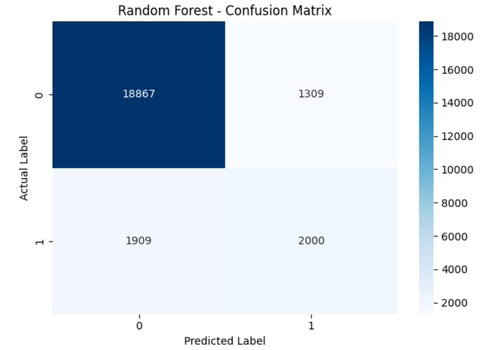
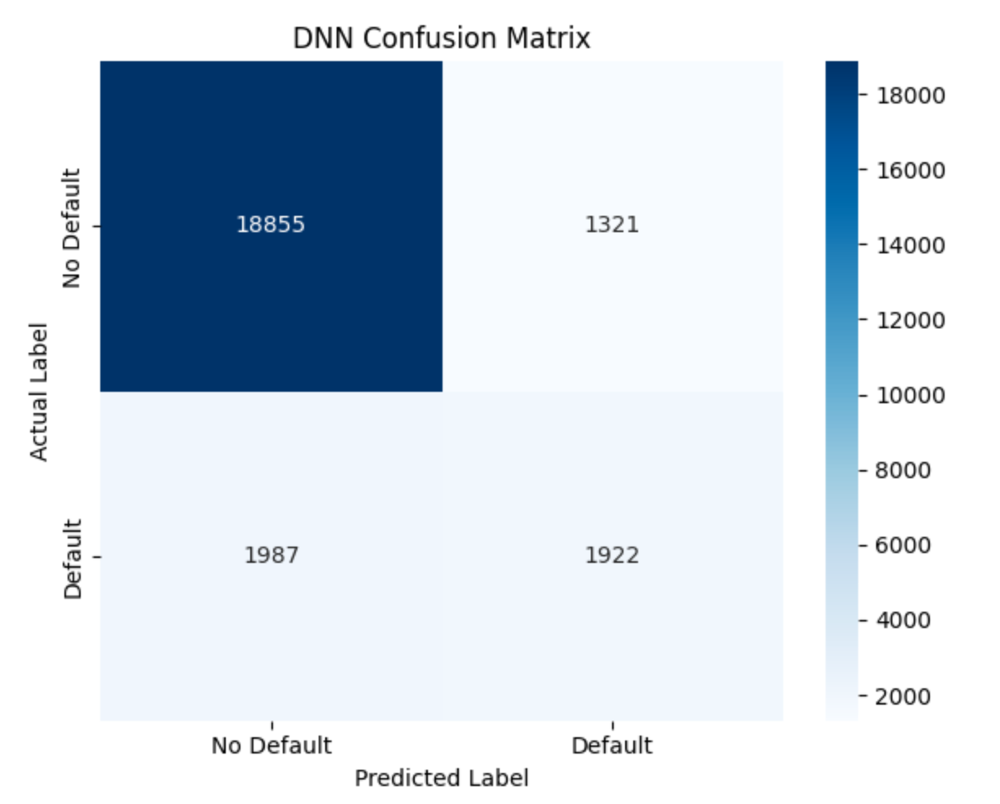
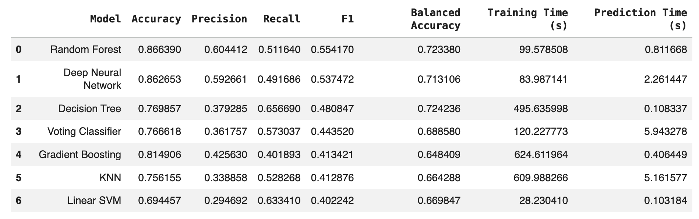
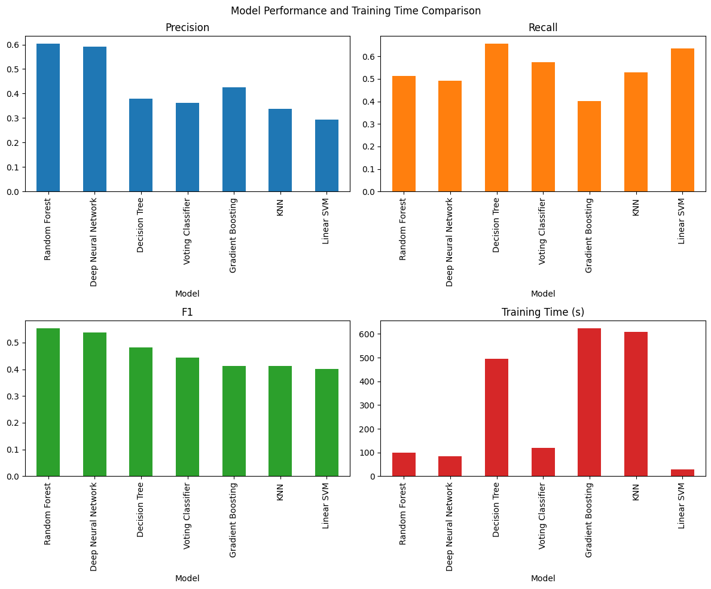

# Loan Default Risk Prediction: Model Development, Evaluation, and Comparison

## 1. Project Overview
This project focuses on developing and evaluating machine learning models to predict loan default using historical borrower and loan data. Building on the earlier exploratory data analysis and baseline model, this phase compares multiple classification algorithms and uses cross-validation and hyperparameter tuning to improve predictive performance. The results are evaluated to identify a suitable model that can support financial institutions in assessing credit risk and making more informed lending decisions.

## 2. Research Question and Business Objective
### Research Question
Can we identify borrowers who are at higher risk of default so that a financial institution can make better lending and credit-risk decisions?

### Business Objective
The objective of this project is to develop and compare machine learning classification models that identify borrowers at risk of loan default using historical borrower and loan data. Model performance will be evaluated using appropriate metrics, with particular emphasis on the F1-score because the dataset contains more non-default than default cases.
The findings aim to identify a suitable predictive model that can help financial institutions assess credit risk more effectively, while recognizing that model predictions should support professional lending decisions.

## 3. Dataset Overview
The project uses the publicly available Loan Default Dataset from Kaggle, containing 148,670 observations and 34 original features. The target variable, Status, indicates whether a borrower defaulted on a loan (1) or did not default (0).
During the initial project phase, the data was inspected, cleaned, and explored. Missing values, duplicate records, irrelevant identifiers, features with limited variation, and anomalous values were reviewed. Features that could not meaningfully support comparisons between default and non-default cases were removed. After preparation, the dataset contained 120,422 observations and 26 features, including the target variable, with no remaining missing values.
Exploratory analysis identified patterns associated with default rates, including lump-sum payment arrangements, negative amortization, loan type, income, and debt-to-income ratio. These findings informed the subsequent modeling phase, which uses the prepared data to train, compare, and evaluate multiple classification models.

## 4. Key Findings from Exploratory Data Analysis
The exploratory data analysis examined borrower and loan characteristics to identify patterns associated with loan default. The findings showed that certain loan features and financial characteristics were associated with different observed default rates.
Among the categorical features, lump-sum payment arrangements and negative amortization showed particularly clear differences in default rates. The categories associated with these payment characteristics generally had higher observed default rates than their alternatives. Loan type also showed meaningful differences, with Type 2 generally having higher default rates than Type 1. These patterns suggest that loan structure and repayment arrangements may provide useful information when assessing default risk.
The analysis of numerical features showed that borrowers who defaulted generally had lower average income and lower average property values than borrowers who did not default. Debt-to-income ratio (DTI), which reflects debt relative to income, also showed a relationship with default rates. The 50–60 DTI range had the highest observed default rate at 42.67%, indicating that this group represented a higher-risk segment within the dataset.
The analysis also found relationships among loan characteristics, particularly between loan amount and property value. In addition, default patterns varied when features were examined together, suggesting that no single characteristic fully explains loan default.
Overall, the findings indicate that borrower finances, loan structure, and repayment characteristics can help distinguish groups with different observed levels of default risk. 

## 5. Modeling Approach
The prepared dataset was used to develop and compare multiple classification models for predicting loan default. The modeling process included Logistic Regression as a baseline, followed by Decision Tree, Random Forest, K-Nearest Neighbors (KNN), Linear Support Vector Machine (SVM), Gradient Boosting, Voting Classifier, and Deep Neural Network models. Cross-validation and GridSearchCV were used to evaluate model performance and tune selected hyperparameters. The models were then compared using consistent evaluation metrics to identify the most suitable approach for predicting loan default.

## 6. Model Evaluation Metrics
The models were evaluated using accuracy, precision, recall, F1-score, and accuracy. Training and prediction times were also recorded to compare computational efficiency.
Because the dataset contains more non-default cases than default cases, accuracy alone may not provide a complete picture of model performance. Precision measures how often borrowers predicted to default actually defaulted, while recall measures how many actual defaults the model successfully identified. The F1-score combines precision and recall into a single measure, making it an important metric for comparing the models in this project. Accuracy was also included to account for performance across both default and non-default groups.
The primary focus was the F1-score, while recall, accuracy, and processing times were considered alongside it to provide a broader assessment of each model's usefulness for loan-default prediction.
The confusion matrices below show how the two best-performing models, Random Forest and Deep Neural Network, correctly identified loan defaults and non-defaults and where their predictions were incorrect.

  
  &nbsp;&nbsp;
  

## 7. Model Comparison and Results
The classification models were compared to determine how effectively they could identify borrowers at risk of loan default. The comparison considered prediction quality, the ability to identify actual defaults, and the time required to train and use each model.

 

  

The results show that Random Forest achieved the highest F1-score of 0.5542 (55.42%), along with an accuracy of 86.64%. In practical terms, accuracy indicates how often the model's predictions were correct overall, while the F1-score provides a more balanced view of how well it identifies potential defaulters without relying too heavily on one type of prediction. Random Forest also achieved the highest precision (60.44%) among the evaluated models. This means that, among borrowers it predicted would default, approximately 60 out of every 100 actually defaulted.

  

 

The results also highlight a trade-off between the models. The Decision Tree achieved the highest recall (65.67%), meaning it identified a larger share of actual defaults than the other models listed. However, its F1-score was lower (48.08%) than Random Forest's. In a lending context, higher recall can help identify more borrowers who may default, but it can also mean flagging more borrowers who would not default. The Deep Neural Network ranked second in F1-score at 53.74%, close to Random Forest, but did not outperform it on the primary metric.
Overall, Random Forest was selected as the leading candidate because it achieved the highest F1-score while also maintaining strong overall accuracy and precision. The final decision considered the balance between identifying potential defaults and avoiding incorrect risk flags, rather than relying on accuracy alone. These results can help inform credit-risk assessment, but model predictions should support further review rather than determine lending decisions on their own.

## 8. Final Model Selection
The Random Forest model was selected as the final model because it achieved the highest F1-score (0.5542), accuracy (86.64%), and precision (60.44%) among the evaluated models. From a business perspective, this means it provided the best overall balance between identifying borrowers at risk of default and avoiding incorrect risk flags. 
The final model used max_features=12 and n_estimators=150, based on the tuning process. The first setting controls how many borrower and loan characteristics are considered when building each decision tree, while the second means the model combines predictions from 150 trees. These settings were retained based on the evaluation results.

## 9. Key Findings
The exploratory analysis found that loan default rates varied across borrower financial characteristics and loan structures. Lump-sum payment arrangements, negative amortization, and loan type showed differences in observed default rates. Borrowers who defaulted generally had lower average incomes and property values, while borrowers with a debt-to-income ratio (DTI) of 50–60 had the highest observed default rate at 42.67%. These patterns highlight borrower and loan characteristics that may help financial institutions recognize groups with higher observed default risk, although they do not prove that these factors directly cause default.
The modeling results showed that Random Forest performed best among the evaluated models based on the primary metric, F1-score (0.5542), with 86.64% accuracy and 60.44% precision. This makes it the preferred model in this project for identifying potential default risk, although its predictions are not always correct. Overall, the analysis provides insights into patterns associated with loan default, while the selected model offers a way to estimate risk based on borrower and loan information. Both findings can inform future credit-risk assessment, subject to further validation before real-world use.

## 10. Next Steps and Recommendations
Future work should focus on collecting more targeted, complete, and reliable customer and loan data. The information should clearly describe customers' financial situations and loan characteristics, with missing or inaccurate values addressed wherever possible. More relevant and clearly defined data may help the models identify meaningful patterns and improve the reliability of loan-default predictions.
Based on this project's results, Random Forest and the Deep Neural Network are promising models for further evaluation, as they achieved the two highest F1-scores among the models tested. Random Forest is the preferred model in this project, while the Neural Network provides a useful alternative for comparison. Future work should test both models on new data to confirm their performance before they are considered for practical credit-risk assessment.
